<p align="center">
  <a href="https://akcit.ufg.br/"></a>
</p>

# SecurePass — Gerador de Senhas Seguras

Aplicação em Python que gera senhas aleatórias e **criptograficamente seguras** a partir de critérios configuráveis. Oferece três interfaces que compartilham **o mesmo núcleo de regras de negócio**:

- **Interface web** responsiva (FastAPI + Jinja2 + HTML/CSS/JS);
- **API REST** (`POST /api/v1/passwords/generate`);
- **CLI** (`python -m app.cli`).

<p align="center">
  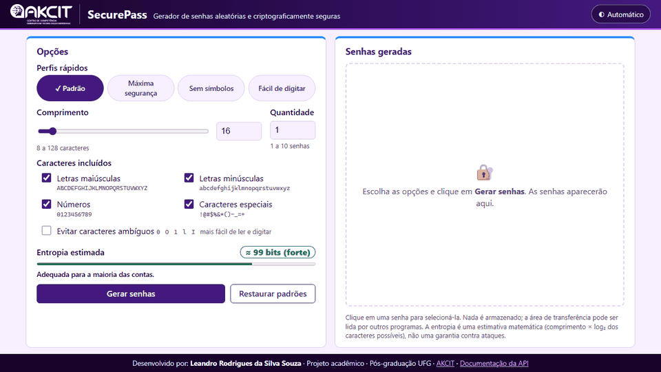
  <br><em>Interface web em execução (veja a <a href="#demonstração-visual">demonstração passo a passo</a>).</em>
</p>

> Projeto acadêmico de laboratório (Pós-graduação — UFG / [AKCIT](https://akcit.ufg.br/)), focado em fundamentos de Engenharia de Software: Clean Code, TDD, separação de responsabilidades e segurança de aplicações.

**Desenvolvido por:** Leandro Rodrigues da Silva Souza

---

## Sumário

1. [Problema](#1-problema)
2. [Objetivos](#2-objetivos)
3. [Funcionalidades](#3-funcionalidades)
4. [Tecnologias](#4-tecnologias)
5. [Decisões arquiteturais](#5-decisões-arquiteturais) — inclui os [diagramas de funcionamento](#diagramas-de-funcionamento)
6. [Estrutura de diretórios](#6-estrutura-de-diretórios)
7. [Pré-requisitos](#7-pré-requisitos)
8. [Instalação](#8-instalação)
9. [Inicialização](#9-inicialização)
10. [Uso pela web](#10-uso-pela-web) (inclui usabilidade e identidade visual AKCIT)
11. [Uso pela CLI](#11-uso-pela-cli)
12. [Uso da API](#12-uso-da-api)
13. [Testes](#13-testes)
14. [Comandos do Makefile](#14-comandos-do-makefile)
15. [Execução no VS Code](#15-execução-no-vs-code)
16. [Segurança das senhas](#16-segurança-das-senhas)
17. [Limitações](#17-limitações)
18. [Evolução](#18-evolução)
19. [Histórico de commits](#19-histórico-de-commits)
20. [Checklist de verificação](#20-checklist-de-verificação)
21. [Licença](#21-licença)
22. [Uso de IA Generativa](#22-uso-de-inteligência-artificial-generativa)

---

## 1. Problema

Senhas criadas por pessoas tendem a ser curtas, previsíveis e reutilizadas. Muitos geradores simples usam o módulo `random`, cujo gerador (Mersenne Twister) é **previsível**: observando saídas suficientes é possível reconstruir o estado interno e prever as próximas. O SecurePass resolve isso usando exclusivamente a fonte de aleatoriedade segura do sistema operacional (módulo `secrets`) e garantindo que a senha respeite exatamente as categorias escolhidas.

## 2. Objetivos

- Gerar senhas com aleatoriedade criptograficamente segura.
- Permitir configuração de comprimento, categorias de caracteres e quantidade.
- Garantir ao menos um caractere de cada categoria marcada e nenhum de categorias desmarcadas.
- Manter uma única implementação da regra de negócio, reutilizada por web, API e CLI.
- Demonstrar TDD, Clean Code, tipagem, documentação e uso responsável de IA.

## 3. Funcionalidades

| Requisito  | Descrição                                                                                                    | Onde                                                                       |
| ---------- | -------------------------------------------------------------------------------------------------------------- | -------------------------------------------------------------------------- |
| RF01       | Comprimento de 8 a 128 (padrão 16), com validação                                                           | `app/core/constants.py`, `password_generator.py`                       |
| RF02–RF05 | Maiúsculas, minúsculas, números e símbolos `!@#$%&*()-_=+`                                               | `app/core/constants.py`                                                  |
| RF06       | Ao menos um caractere por categoria marcada; nenhum de desmarcadas                                             | `generate_password`                                                      |
| RF07       | `secrets.choice` + Fisher–Yates com `secrets.randbelow`                                                   | `generate_password`, `secure_shuffle`                                  |
| RF08       | 1 a 10 senhas por solicitação                                                                                | `generate_passwords`                                                     |
| RF09       | Interface web responsiva, cópia, regeneração, validação e indicador de entropia                           | `app/templates`, `app/static`                                          |
| RF10       | CLI com mensagens claras e códigos de saída                                                                  | `app/cli.py`                                                             |
| RF11       | `POST /api/v1/passwords/generate` com validação Pydantic                                                   | `app/api/routes.py`, `app/schemas/password.py`                         |
| Extra      | Opção de excluir caracteres ambíguos `0 O 1 l I` (web, API e CLI)                                         | `AMBIGUOUS_CHARACTERS`, `select_character_sets(exclude_ambiguous=...)` |
| Extra      | Perfis rápidos, ocultar/limpar senhas, cores por tipo de caractere, tema manual, dicas por nível de entropia | `app/main.py` (`PRESETS`), `app/templates`, `app/static`           |

## 4. Tecnologias

| Camada             | Tecnologia                                             | Versão fixada             |
| ------------------ | ------------------------------------------------------ | -------------------------- |
| Linguagem          | Python                                                 | 3.12+ (validado em 3.13.5) |
| Backend web        | FastAPI                                                | 0.147.0                    |
| Servidor ASGI      | Uvicorn                                                | 0.54.0                     |
| Templates          | Jinja2                                                 | 3.1.6                      |
| Frontend           | HTML5, CSS3, JavaScript (sem frameworks)               | —                         |
| Testes             | Pytest / pytest-cov                                    | 9.1.1 / 7.1.0              |
| Testes da API      | HTTPX (via `TestClient`)                             | 0.28.1                     |
| Formatação       | Black                                                  | 26.10.1                    |
| Análise estática | Ruff (inclui regras de segurança Bandit e docstrings) | 0.17.1                     |
| Automação        | GNU Make                                               | —                         |

Nenhum banco de dados, autenticação ou serviço externo é utilizado.

## 5. Decisões arquiteturais

**Arquitetura em camadas simples**, sem abstrações artificiais:

```text
      Navegador (HTML/CSS/JS)          Terminal
              │ fetch POST JSON            │
              ▼                            ▼
   app/main.py + app/api/routes.py     app/cli.py         ← apresentação / interfaces
              │  (app/schemas: contrato Pydantic)
              └──────────────┬─────────────┘
                             ▼
              app/core/password_generator.py              ← domínio (regras de negócio)
                             │
              app/core/constants.py                       ← configuração única
```

- **Núcleo independente das interfaces.** `password_generator.py` não importa FastAPI, argparse nem nada de apresentação. Por isso é testado isoladamente e reutilizado sem duplicação (DRY, SRP).
- **Constantes como fonte única de verdade.** Limites e conjuntos de caracteres ficam em `constants.py`. O Pydantic, a CLI e o template HTML leem esses valores; o HTML recebe até os tamanhos dos conjuntos (`data-pool-size`) para o indicador de entropia, de modo que o JavaScript não redefine os caracteres. `CHARACTER_SETS` é um `MappingProxyType` (somente leitura), evitando estado global mutável.
- **Funções em vez de classes.** O gerador não tem estado; uma classe ou interface (ex.: `PasswordGeneratorProtocol`) não traria benefício concreto (YAGNI/KISS). SOLID aparece onde ajuda: responsabilidade única por módulo e dependência das interfaces em relação ao domínio, nunca o inverso.
- **Validação em duas camadas, sem duplicar regras.** O Pydantic valida *estrutura* (tipos em modo estrito, faixas, campos extras proibidos). O núcleo valida *regras de negócio* (categorias, comprimento ≥ nº de categorias) e é a autoridade final; a API apenas converte `PasswordGenerationError` em HTTP 422.
- **Exceções explícitas.** `PasswordGenerationError` (subclasse de `ValueError`) para valores inválidos; `TypeError` para tipos incorretos (incluindo `bool`, que em Python é subclasse de `int`).
- **O JavaScript não gera senhas.** Toda geração ocorre no backend com `secrets`; o JS apenas valida o formulário, calcula a estimativa de entropia e exibe resultados.
- **Adaptações da estrutura proposta** (com justificativa):
  - Os arquivos ficam na raiz do repositório (`GeradorSenhas/`) em vez de uma subpasta `securepass/`, pois o repositório já é o projeto.
  - `tests/test_web.py` foi adicionado para separar os testes da página/arquivos estáticos dos testes do contrato da API.
  - `.gitattributes` força finais de linha LF (o Makefile exige tabulações e LF; o Git no Windows convertia para CRLF).
  - `.vscode/` não é versionado (está no `.gitignore`): são preferências locais do editor. A seção 15 traz um modelo para quem quiser recriá-las.

### Diagramas de funcionamento

Os diagramas abaixo usam [Mermaid](https://mermaid.js.org/), desenhado automaticamente pelo GitHub. No VS Code, instale a extensão *Markdown Preview Mermaid Support* para vê-los na pré-visualização.

#### Visão geral

Web, API e CLI são apenas portas de entrada: todas chegam ao mesmo núcleo, que é o único lugar onde senhas são geradas. Os limites e os tamanhos dos conjuntos de `constants.py` também são enviados ao HTML, para que a página nunca divirja das regras do backend.

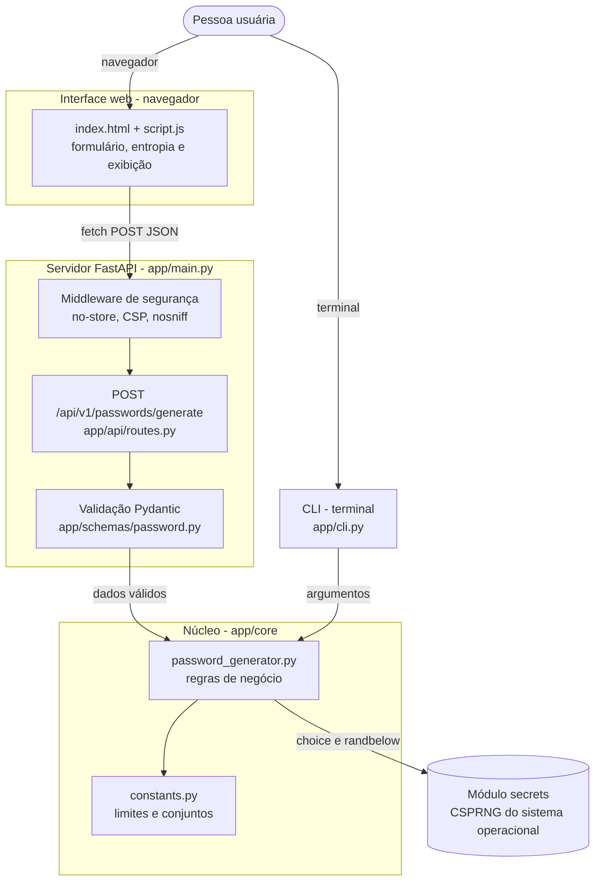

#### Geração de senhas pela web

O JavaScript só valida e exibe; quem gera é o backend. Erros de tipo ou faixa são barrados pelo Pydantic, e regras de negócio pelo núcleo — ambos voltam como HTTP 422.

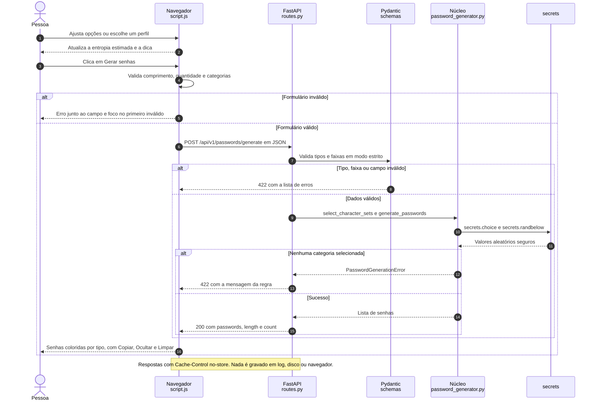

#### Algoritmo de geração de uma senha

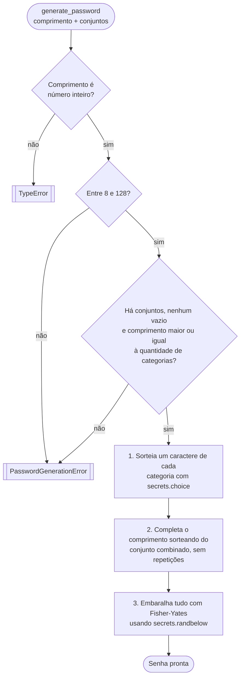

Com **Evitar caracteres ambíguos**, `select_character_sets` remove `0 O 1 l I` dos conjuntos antes desses passos. Embaralhar no fim impede que os caracteres obrigatórios fiquem sempre nas primeiras posições.

## 6. Estrutura de diretórios

```text
GeradorSenhas/
├── app/
│   ├── __init__.py
│   ├── main.py                    # App FastAPI, página inicial, cabeçalhos de segurança
│   ├── cli.py                     # Interface de linha de comando
│   ├── api/
│   │   ├── __init__.py
│   │   └── routes.py              # POST /api/v1/passwords/generate
│   ├── core/
│   │   ├── __init__.py
│   │   ├── constants.py           # Limites e conjuntos de caracteres
│   │   └── password_generator.py  # Regras de negócio e geração segura
│   ├── schemas/
│   │   ├── __init__.py
│   │   └── password.py            # Modelos Pydantic (contrato da API)
│   ├── templates/
│   │   └── index.html
│   └── static/
│       ├── css/style.css          # Paleta de cores AKCIT
│       ├── img/                   # Imagens do AKCIT: logos (barra superior e README) e favicon
│       └── js/script.js
├── docs/
│   └── img/                       # Capturas de tela e GIF de demonstração do README
├── tests/
│   ├── conftest.py
│   ├── test_password_generator.py
│   ├── test_api.py
│   ├── test_web.py
│   └── test_cli.py
├── .gitattributes
├── .gitignore
├── LICENSE
├── Makefile
├── pyproject.toml
├── README.md
└── requirements.txt
```

## 7. Pré-requisitos

- Python **3.12 ou superior** (`python --version`).
- Git.
- Opcional: GNU Make (no Windows, os comandos manuais equivalentes estão na seção 14).
- Opcional: VS Code com as extensões *Python*, *Black Formatter* e *Ruff*.

## 8. Instalação

```bash
git clone <URL-DO-REPOSITORIO> GeradorSenhas
cd GeradorSenhas
python -m venv .venv
```

Ative o ambiente virtual:

| Sistema              | Comando                          |
| -------------------- | -------------------------------- |
| Windows (PowerShell) | `.\.venv\Scripts\Activate.ps1` |
| Windows (cmd)        | `.venv\Scripts\activate.bat`   |
| Linux/macOS          | `source .venv/bin/activate`    |

> No PowerShell, se a ativação for bloqueada pela política de execução, rode antes (vale apenas para a sessão atual):
> `Set-ExecutionPolicy -Scope Process -ExecutionPolicy RemoteSigned`

Instale as dependências:

```bash
make install
# ou, sem Make:
python -m pip install -r requirements.txt
```

## 9. Inicialização

Sempre a partir da raiz do projeto (pasta `GeradorSenhas`), depois de concluir a instalação (seção 8). Escolha uma das opções:

### Opção A — ativando o ambiente virtual (recomendada)

Ative o `.venv` e inicie o servidor com o Python do ambiente:

| Sistema | 1. Ativar o ambiente | 2. Iniciar o servidor |
| --- | --- | --- |
| Windows (PowerShell) | `.\.venv\Scripts\Activate.ps1` | `python -m uvicorn app.main:app --reload --host 127.0.0.1 --port 8000` |
| Windows (cmd) | `.venv\Scripts\activate.bat` | `python -m uvicorn app.main:app --reload --host 127.0.0.1 --port 8000` |
| Linux/macOS | `source .venv/bin/activate` | `python -m uvicorn app.main:app --reload --host 127.0.0.1 --port 8000` |

Com o ambiente ativado, o terminal mostra `(.venv)` no início da linha. Esse é o comando validado no Windows (PowerShell). Para sair do ambiente depois de encerrar o servidor, use `deactivate`.

### Opção B — usando o Python do `.venv` diretamente (sem ativar)

Útil quando a ativação é bloqueada pela política de execução do PowerShell ou em scripts:

```powershell
# Windows (PowerShell ou cmd)
.\.venv\Scripts\python.exe -m uvicorn app.main:app --reload --host 127.0.0.1 --port 8000
```

```bash
# Linux/macOS
.venv/bin/python -m uvicorn app.main:app --reload --host 127.0.0.1 --port 8000
```

### Opção C — Make ou VS Code

- `make run` (requer GNU Make; executa o mesmo comando da opção A).
- VS Code: *Run and Debug* → **SecurePass: servidor web** → F5, após criar o `.vscode/launch.json` da seção 15.

### Observações

- Usar `python -m uvicorn` (em vez do executável `uvicorn`) garante que o Uvicorn do ambiente virtual seja usado, mesmo que ele não esteja no `PATH`.
- Se aparecer `No module named uvicorn`, o Python em uso não é o do `.venv`: ative o ambiente (opção A) ou use a opção B, e confirme que as dependências foram instaladas.
- `--reload` reinicia o servidor ao salvar arquivos (uso em desenvolvimento). Para outra porta, troque `--port 8000`.
- Para encerrar o servidor, pressione `Ctrl+C` no terminal.

Com o servidor em execução:

- Interface web: [http://127.0.0.1:8000/](http://127.0.0.1:8000/)
- Documentação interativa (Swagger UI): [http://127.0.0.1:8000/docs](http://127.0.0.1:8000/docs)
- Esquema OpenAPI: [http://127.0.0.1:8000/openapi.json](http://127.0.0.1:8000/openapi.json)

## 10. Uso pela web

<p align="center">
  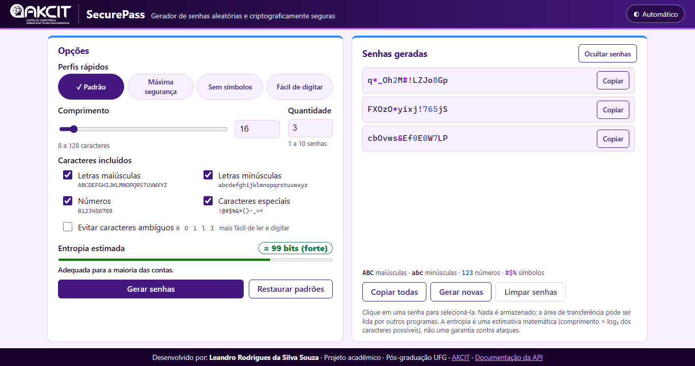
  <br><em>Aplicação em execução em <code>http://127.0.0.1:8000/</code> após gerar 3 senhas com as opções padrão.</em>
</p>

Com o servidor em execução (seção 9):

A interface é uma **página única em duas colunas**: as configurações ficam à esquerda e as senhas geradas à direita, sob uma barra superior compacta com o logo do AKCIT ao lado do nome SecurePass. Em notebooks e monitores (a partir de 1280×720) tudo cabe na janela, sem barra de rolagem; com 10 senhas longas, apenas a lista de senhas rola por dentro do cartão. Em telas estreitas (celular) as colunas se empilham e a página rola normalmente.

1. Acesse [http://127.0.0.1:8000/](http://127.0.0.1:8000/).
2. Opcional: escolha um **perfil rápido**, que preenche as opções em um clique (o perfil ativo fica marcado com ✓):
   | Perfil             | Configuração                          | Quando usar                                           |
   | ------------------ | --------------------------------------- | ----------------------------------------------------- |
   | Padrão            | 16 caracteres, todas as categorias      | Uso geral                                             |
   | Máxima segurança | 32 caracteres, todas as categorias      | Contas críticas, senhas mestras                      |
   | Sem símbolos      | 20 caracteres, sem caracteres especiais | Sites que não aceitam símbolos                      |
   | Fácil de digitar  | 16 caracteres, sem `0 O 1 l I`        | Senhas que serão lidas e digitadas em outro aparelho |
3. Ajuste o comprimento (controle deslizante ou campo numérico, 8–128).
4. Marque as categorias desejadas (pelo menos uma) e, se quiser, **Evitar caracteres ambíguos**.
5. Defina a quantidade de senhas (1–10).
6. Observe o indicador de **entropia estimada**: a etiqueta muda de cor conforme o nível (fraca, razoável, forte, muito forte) e uma dica explica para que tipo de conta a senha é adequada.
7. Clique em **Gerar senhas** (ou pressione **Enter**). Cada senha aparece colorida por tipo de caractere (números em azul, símbolos em lilás) e tem um botão **Copiar**; com mais de uma senha aparece também **Copiar todas** (uma por linha).
8. Use **Ocultar senhas** ao compartilhar a tela (o botão Copiar continua funcionando), **Gerar novas senhas** para outro lote, **Limpar senhas** para tirá-las da tela ao terminar, ou **Restaurar padrões** para voltar à configuração inicial.
9. O botão de tema, no canto direito da barra superior, alterna entre **Automático** (segue o sistema), **Claro** e **Escuro**.

Entradas inválidas (comprimento fora da faixa, quantidade inválida, nenhuma categoria) exibem mensagens junto ao campo antes do envio; o servidor valida novamente e suas mensagens de erro também são exibidas.

### Demonstração visual

Capturas feitas com a aplicação em execução (`python -m uvicorn app.main:app`) no Microsoft Edge. As senhas que aparecem nas imagens são aleatórias, foram geradas só para a demonstração e não devem ser usadas.

**1. Página inicial.** Configurações à esquerda e área de resultado à direita, que indica onde as senhas vão aparecer. Os valores padrão (16 caracteres, quatro categorias, 1 senha) já resultam em ≈ 99 bits de entropia estimada, e o indicador é atualizado enquanto as opções mudam.

<p align="center">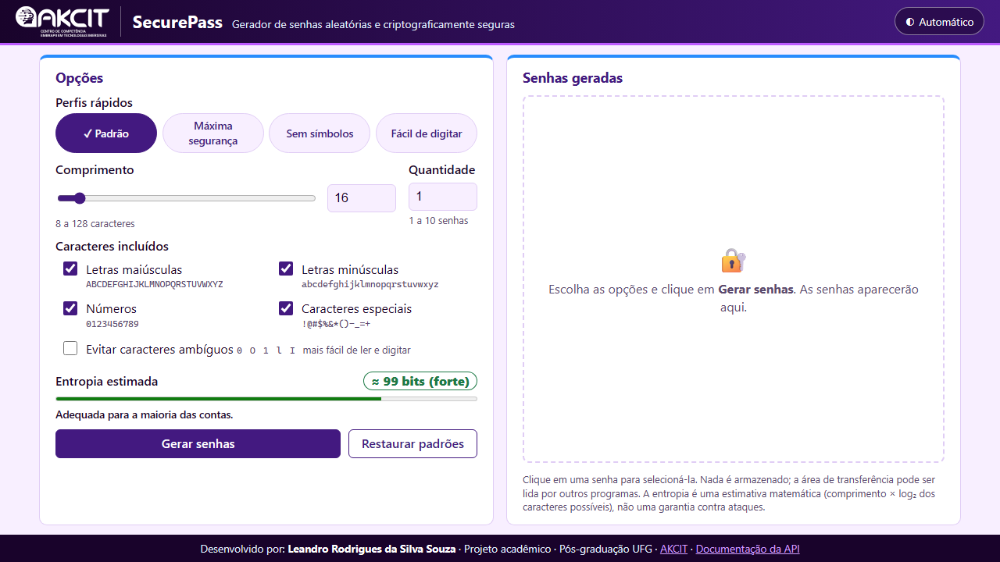</p>

**2. Validação.** Com comprimento 4 e nenhuma categoria marcada, cada campo mostra sua mensagem de erro, a borda fica destacada e o foco vai para o primeiro campo inválido. Nenhuma requisição é enviada.

<p align="center">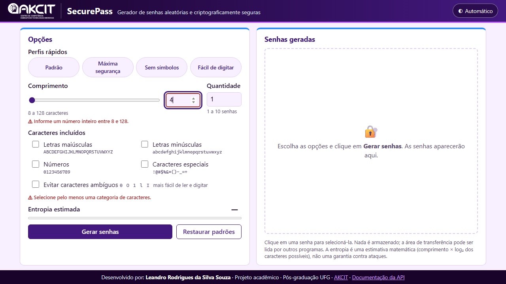</p>

**3. Senhas geradas.** Com 20 caracteres e 3 senhas, o resultado aparece na coluna da direita, com cada caractere colorido por tipo e uma legenda. Cada senha tem o botão **Copiar** (com a confirmação "Copiado!"), e há também **Copiar todas**, **Gerar novas senhas** e **Limpar senhas**.

<p align="center">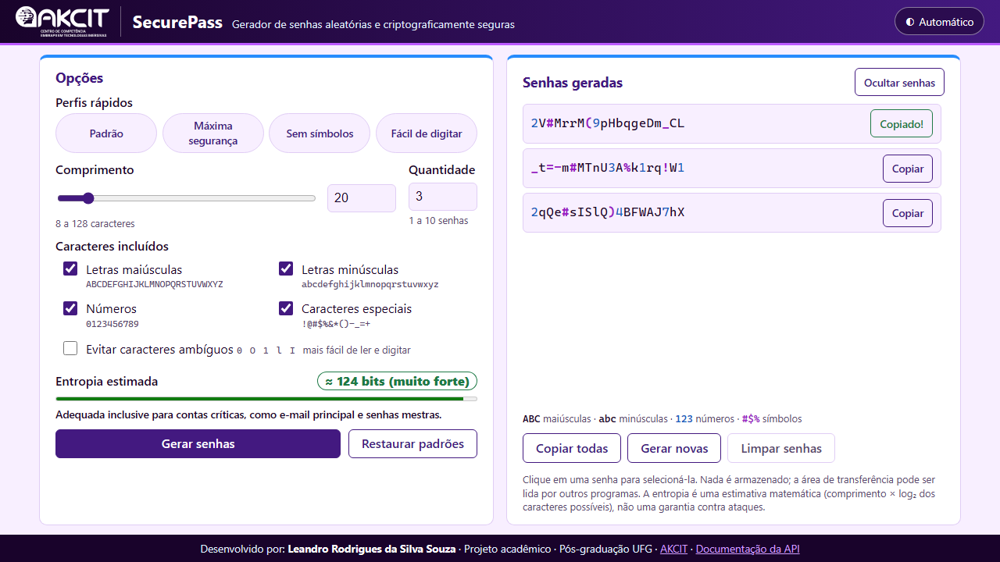</p>

**4. Senhas ocultas.** Com **Ocultar senhas**, os caracteres são trocados por pontos — útil ao compartilhar a tela. A cópia continua funcionando.

<p align="center">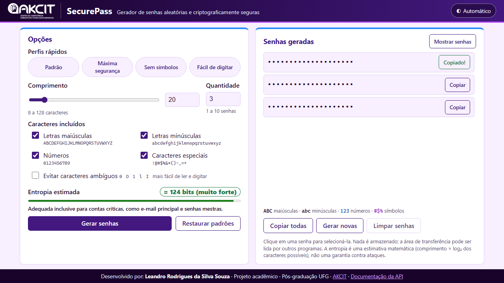</p>

**5. Tema escuro e celular.** A página segue o tema do sistema operacional (ou o escolhido no botão de tema) e se adapta a telas estreitas: as colunas se empilham, os botões ocupam a largura toda e não há rolagem horizontal.

<p align="center">
  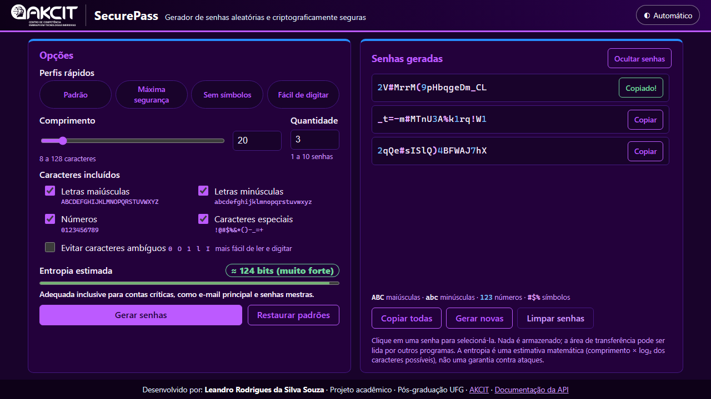
   
  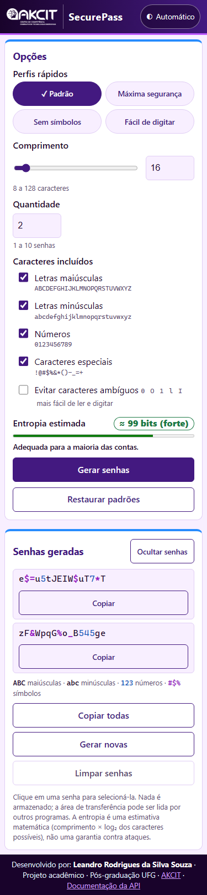
</p>

### Boas práticas de usabilidade e acessibilidade

| Prática                    | Como foi aplicada                                                                                                                                                                                                                         |
| --------------------------- | ----------------------------------------------------------------------------------------------------------------------------------------------------------------------------------------------------------------------------------------- |
| Erros junto ao campo        | Cada campo tem sua mensagem (⚠) ligada por `aria-describedby`; a borda do campo fica destacada (`aria-invalid`).                                                                                                                     |
| Foco no problema            | Ao enviar com erros, o foco vai para o primeiro campo inválido.                                                                                                                                                                          |
| Validação sem incomodar   | Os erros só aparecem após a primeira tentativa de envio; a partir daí somem assim que o valor é corrigido.                                                                                                                            |
| Feedback de estado          | Botão mostra "Gerando…"; a lista fica esmaecida durante a requisição (`aria-busy`); cópia confirma com "Copiado!".                                                                                                                 |
| Leitores de tela            | Região `role="status"` anuncia "3 senhas geradas", "Senha 2 copiada", "Opções restauradas" etc.                                                                                                                                      |
| Foco após a ação         | Depois de gerar, o foco e a rolagem vão para "Senhas geradas"; ao regenerar, o foco permanece no botão usado.                                                                                                                           |
| Botões não perdem o foco  | Durante o carregamento usa-se `aria-disabled` em vez de `disabled`, que tiraria o foco do teclado.                                                                                                                                    |
| Controle e liberdade        | Botão **Restaurar padrões**; os valores padrão já produzem senhas fortes (texto de orientação no topo do formulário).                                                                                                        |
| Cópia facilitada           | **Copiar todas**; um clique na senha seleciona o texto inteiro; se a área de transferência não estiver disponível (fora de HTTPS/localhost), o texto é selecionado e a página orienta a usar Ctrl+C.                          |
| Navegação por teclado     | Link "Pular para o gerador" visível ao pressionar Tab; foco sempre visível (`:focus-visible`).                                                                                                                                        |
| Página única              | Duas colunas (configurações → resultado) que cabem na janela de notebooks e monitores, sem rolagem da página; a pessoa vê as opções e as senhas ao mesmo tempo. A área de resultado mostra uma orientação enquanto está vazia. |
| Alvos de clique e toque     | Botões, campos e caixas de seleção com no mínimo 36 px com mouse (acima dos 24 px da WCAG 2.5.8) e 44 px em telas de toque (`pointer: coarse`); no celular os botões ocupam a largura toda.                                        |
| Movimento reduzido          | Com `prefers-reduced-motion`, a rolagem é instantânea e não há animações.                                                                                                                                                         |
| Legibilidade                | Senhas em fonte monoespaçada maior, com espaçamento entre letras e **cores por tipo de caractere** (com legenda).                                                                                                                 |
| Atalhos para tarefas comuns | **Perfis rápidos** aplicam combinações frequentes em um clique; o perfil que corresponde às opções atuais fica destacado (`aria-pressed`).                                                                                  |
| Prevenção de erros        | **Evitar caracteres ambíguos** (`0 O 1 l I`) para senhas que serão digitadas manualmente; a entropia é recalculada com o conjunto menor.                                                                                       |
| Orientação contextual     | A etiqueta de entropia muda de cor por nível e uma dica explica o uso adequado ("Para contas importantes, prefira 80 bits ou mais").                                                                                                     |
| Privacidade na tela         | **Ocultar senhas** (útil ao compartilhar a tela; a cópia continua funcionando e o estado vale também para novos lotes) e **Limpar senhas** ao terminar.                                                                    |
| Preferência visual         | Botão de tema **Automático / Claro / Escuro** na barra superior. A escolha vale para a visita atual: a página não grava nada no navegador (ver seção 16).                                                                     |

Essas práticas foram verificadas com um teste E2E descartável no Microsoft Edge headless (via Chrome DevTools Protocol), cobrindo erros inline, foco, anúncios, restaurar padrões, copiar todas (incluindo o caminho alternativo), perfis rápidos, exclusão de ambíguos em 10 senhas de 128 caracteres, cores por tipo, ocultar/mostrar, limpar, os três temas (inclusive "Claro" sobrepondo o sistema escuro), ausência de rolagem horizontal em 375 px, altura mínima dos alvos de toque e ausência de erros no console.

### Identidade visual (AKCIT)

A interface segue o esquema de cores e o logotipo do [AKCIT — Centro de Competência EMBRAPII em Tecnologias Imersivas](https://akcit.ufg.br/):

| Uso                                          | Cor                                                 | Origem no site do AKCIT   |
| -------------------------------------------- | --------------------------------------------------- | ------------------------- |
| Barra superior e rodapé (degradê)          | `#19032B` → `#431980`                          | Fundo roxo-escuro do site |
| Cor primária (botões, títulos, controles) | `#431980` (claro) / `#BC5AFF` (escuro)          | Roxo e lilás de destaque |
| Detalhe dos cartões                         | `#278CFD`                                         | Azul de destaque          |
| Fundo da página                             | `#F8EFFF` (claro) / `#19032B` (escuro)          | Tons de fundo do site     |
| Fonte                                        | Montserrat (se instalada; senão, fonte do sistema) | Fonte do site             |

Imagens baixadas de [https://akcit.ufg.br/](https://akcit.ufg.br/) e salvas em `app/static/img/`:

| Arquivo                   | Original no site         | Uso                                                             | Tratamento                       |
| ------------------------- | ------------------------ | --------------------------------------------------------------- | -------------------------------- |
| `logo-akcit-branca.png` | `/logoAkcitBranca.png` | Barra superior, à esquerda de "SecurePass" (link para o AKCIT) | Recortado e reduzido para 480 px |
| `logo-akcit.png`        | `/logoAkcit.png`       | Topo deste README                                               | Recortado e reduzido para 480 px |
| `favicon.ico`           | `/favicon.ico`         | Ícone da aba do navegador                                      | Sem alteração                  |

- As imagens são **servidas localmente** porque a CSP da página só permite recursos da própria origem (`img-src 'self'`); pelo mesmo motivo a fonte Montserrat não é carregada de CDN.
- Os temas claro e escuro acompanham a preferência do sistema operacional (`prefers-color-scheme`), e o botão de tema permite escolher manualmente.
- O logotipo é marca do AKCIT/UFG e é usado aqui apenas para identificar o vínculo acadêmico do projeto.

## 11. Uso pela CLI

```bash
python -m app.cli --length 20 --uppercase --lowercase --numbers --symbols --count 3
python -m app.cli -l 12 -L -D          # atalhos: -U -L -D -S
python -m app.cli -l 16 -U -L -D -A    # -A / --exclude-ambiguous: sem 0 O 1 l I
python -m app.cli --help
```

Cada senha é impressa em uma linha (stdout). Erros vão para stderr.

| Código de saída | Significado                                                                                               |
| ----------------- | --------------------------------------------------------------------------------------------------------- |
| `0`             | Senhas geradas com sucesso (ou `--help`)                                                                |
| `2`             | Argumentos inválidos: valor fora da faixa, nenhuma categoria, valor não inteiro ou opção desconhecida |

Exemplo de erro:

```text
$ python -m app.cli --length 4 --numbers
Erro: O comprimento deve estar entre 8 e 128 caracteres.
```

Não há categorias marcadas por padrão na CLI: a seleção deve ser explícita, e a ausência de categorias gera erro.

## 12. Uso da API

### Contrato

`POST /api/v1/passwords/generate` — corpo JSON (todos os campos são opcionais):

| Campo                 | Tipo     | Padrão   | Regra                                      |
| --------------------- | -------- | --------- | ------------------------------------------ |
| `length`            | inteiro  | 16        | 8 a 128                                    |
| `uppercase`         | booleano | `true`  | —                                         |
| `lowercase`         | booleano | `true`  | —                                         |
| `numbers`           | booleano | `true`  | —                                         |
| `symbols`           | booleano | `true`  | —                                         |
| `exclude_ambiguous` | booleano | `false` | Remove `0 O 1 l I` de todos os conjuntos |
| `count`             | inteiro  | 1         | 1 a 10                                     |

Validação em **modo estrito**: `"16"` (texto), `16.0`/`16.5` (decimais) e `"yes"` (booleano em texto) são rejeitados; campos desconhecidos também.

| Status  | Quando                                            | Corpo                                                               |
| ------- | ------------------------------------------------- | ------------------------------------------------------------------- |
| `200` | Sucesso                                           | `{"passwords": [...], "length": n, "count": n}`                   |
| `422` | Erro de tipo/faixa/campo extra (Pydantic)         | `{"detail": [ {...}, ... ]}` (lista de erros)                     |
| `422` | Nenhuma categoria selecionada (regra de negócio) | `{"detail": "Selecione pelo menos uma categoria de caracteres."}` |
| `405` | Método diferente de POST                         | —                                                                  |

### Exemplos

As senhas abaixo estão mascaradas propositalmente; a resposta real contém senhas aleatórias.

```bash
curl -X POST http://127.0.0.1:8000/api/v1/passwords/generate \
  -H "Content-Type: application/json" \
  -d '{"length": 16, "uppercase": true, "lowercase": true, "numbers": true, "symbols": true, "count": 1}'
```

```json
{"passwords": ["****************"], "length": 16, "count": 1}
```

PowerShell:

```powershell
Invoke-RestMethod -Method Post -Uri http://127.0.0.1:8000/api/v1/passwords/generate `
  -ContentType "application/json" `
  -Body '{"length": 20, "uppercase": true, "lowercase": false, "numbers": true, "symbols": true, "count": 3}'
```

Erro de regra de negócio:

```bash
curl -X POST http://127.0.0.1:8000/api/v1/passwords/generate \
  -H "Content-Type: application/json" \
  -d '{"uppercase": false, "lowercase": false, "numbers": false, "symbols": false}'
```

```json
{"detail": "Selecione pelo menos uma categoria de caracteres."}
```

## 13. Testes

```bash
make test
# ou, sem Make:
python -m pytest --cov --cov-report=term-missing
```

O desenvolvimento seguiu o ciclo **Red → Green → Refactor**: os testes do núcleo foram commitados antes da implementação (commit `test(core): add failing password generation tests (TDD red)`), e o mesmo foi feito para API, CLI e página web, confirmando a falha antes de implementar.

Cenários cobertos:

- Comprimento mínimo e máximo; abaixo/acima do limite; zero e negativo; não inteiro (`float`, `str`, `None`, `bool`).
- Nenhuma categoria; conjunto vazio; comprimento menor que o número de categorias.
- Apenas maiúsculas, minúsculas, números ou símbolos; todas as categorias.
- Presença obrigatória de cada categoria escolhida e ausência das desmarcadas (testes repetidos no comprimento mínimo, onde a garantia é mais exigida).
- Múltiplas senhas; quantidade inválida e não inteira.
- **Uso de aleatoriedade segura**: `secrets.choice` e `secrets.randbelow` são substituídos por dublês determinísticos, e o teste verifica a saída exata e as chamadas do Fisher–Yates. Não se compara duas senhas aleatórias como "prova" de segurança.
- Contrato da API (campos, padrões, 422, 405), cabeçalhos `no-store` e de segurança, exemplos mascarados no OpenAPI.
- Logo do AKCIT presente na página e todas as imagens servidas pela própria aplicação (compatível com a CSP).
- Exclusão de caracteres ambíguos no núcleo (conjuntos resultantes e 20 senhas de 128 caracteres sem `0 O 1 l I`), na API (incluindo tipo estrito e padrão `false`) e na CLI (`-A`/`--exclude-ambiguous`).
- Perfis rápidos dentro dos limites do domínio; página com tamanhos de conjunto sem ambíguos (`data-pool-size-unambiguous`) e controles de ocultar, limpar, tema e dica de entropia.
- Estrutura de usabilidade da página: link de pular conteúdo, mensagens de erro ligadas aos campos (`aria-describedby`), região de status, botões **Restaurar padrões** e **Copiar todas**, favicon.
- CLI com argumentos válidos, inválidos, `--help` e execução como módulo (`python -m app.cli`).

Resultado da última execução (Windows 11, Python 3.13.5): **130 testes aprovados**, cobertura total de **99%** e **100%** em `app/core`. A única linha não medida é `sys.exit(main())` em `cli.py`, executada em subprocesso pelo teste `test_cli_runs_as_module`. Cobertura alta não é garantia de qualidade; ela só indica que todo o código foi exercitado.

## 14. Comandos do Makefile

| Comando          | Ação                                   | Equivalente manual (Windows sem Make)                                      |
| ---------------- | ---------------------------------------- | -------------------------------------------------------------------------- |
| `make install` | Instala as dependências                 | `python -m pip install -r requirements.txt`                              |
| `make run`     | Inicia o Uvicorn com recarga automática | `python -m uvicorn app.main:app --reload --host 127.0.0.1 --port 8000`   |
| `make test`    | Executa os testes com cobertura          | `python -m pytest --cov --cov-report=term-missing`                       |
| `make format`  | Formata o código com Black              | `python -m black app tests`                                              |
| `make lint`    | Ruff + verificação de formatação     | `python -m ruff check app tests` e `python -m black --check app tests` |

Variáveis podem ser sobrescritas: `make run PORT=9000`, `make install PYTHON=python3`.

> Para ter `make` no Windows: `winget install GnuWin32.Make`, `choco install make` ou usar WSL/Git Bash com Make instalado.

## 15. Execução no VS Code

1. Abra a pasta do projeto no VS Code (`code .`).
2. Instale as extensões recomendadas: **Python**, **Black Formatter** (`ms-python.black-formatter`) e **Ruff** (`charliermarsh.ruff`).
3. Crie o ambiente e instale as dependências (seção 8). Selecione o interpretador do `.venv` com *Ctrl+Shift+P → Python: Select Interpreter*.
4. **Opcional — configurações do projeto.** A pasta `.vscode/` não é versionada (preferências locais). Para ter os atalhos de execução, testes e formatação ao salvar, crie os dois arquivos abaixo:

   `.vscode/launch.json`:

   ```json
   {
     "version": "0.2.0",
     "configurations": [
       {
         "name": "SecurePass: servidor web",
         "type": "debugpy",
         "request": "launch",
         "module": "uvicorn",
         "args": ["app.main:app", "--reload", "--host", "127.0.0.1", "--port", "8000"],
         "jinja": true,
         "justMyCode": true
       },
       {
         "name": "SecurePass: CLI",
         "type": "debugpy",
         "request": "launch",
         "module": "app.cli",
         "args": ["--length", "20", "--uppercase", "--lowercase", "--numbers", "--symbols", "--count", "3"],
         "console": "integratedTerminal"
       }
     ]
   }
   ```

   `.vscode/settings.json` (no Linux/macOS, use `.venv/bin/python`):

   ```json
   {
     "python.defaultInterpreterPath": "${workspaceFolder}/.venv/Scripts/python.exe",
     "python.testing.pytestEnabled": true,
     "python.testing.unittestEnabled": false,
     "python.testing.pytestArgs": ["tests"],
     "[python]": {
       "editor.defaultFormatter": "ms-python.black-formatter",
       "editor.formatOnSave": true,
       "editor.codeActionsOnSave": {
         "source.fixAll.ruff": "explicit",
         "source.organizeImports.ruff": "explicit"
       }
     },
     "files.eol": "\n"
   }
   ```

5. **Executar/depurar**: aba *Run and Debug* (Ctrl+Shift+D) → escolha **SecurePass: servidor web** ou **SecurePass: CLI** → F5.
6. **Testes**: aba *Testing* (ícone de frasco), configurada para Pytest pelo `settings.json`.
7. Com o `settings.json`, a formatação com Black e as correções do Ruff são aplicadas ao salvar arquivos Python.

## 16. Segurança das senhas

### Geração

- **Fonte de aleatoriedade**: `secrets`, que usa o CSPRNG do sistema operacional. O módulo `random` não é usado em nenhum ponto (e o Ruff, com as regras de segurança `S`, apontaria seu uso).
- **Algoritmo** (`generate_password`):
  1. valida tipo e faixa do comprimento;
  2. valida as categorias (ao menos uma, nenhuma vazia, `length >= nº de categorias`);
  3. sorteia **um caractere obrigatório de cada categoria** com `secrets.choice`;
  4. completa o restante sorteando do conjunto combinado (sem caracteres repetidos entre conjuntos, para não enviesar a distribuição);
  5. embaralha tudo com **Fisher–Yates** usando `secrets.randbelow`, para que os caracteres obrigatórios não fiquem nas primeiras posições.

### Indicador de entropia (estimativa)

A interface exibe `entropia ≈ comprimento × log₂(tamanho do conjunto)`, arredondada para baixo. Ex.: 16 caracteres com as 4 categorias (75 símbolos possíveis) ≈ 99 bits.

Limitações desse indicador:

- É uma **estimativa matemática para senhas aleatórias**, não uma garantia contra ataques.
- A garantia de "ao menos um de cada categoria" reduz levemente o espaço de busca; a estimativa ignora essa redução, que é pequena.
- Não considera vazamentos, reutilização, phishing, malware, armazenamento inseguro ou limitações do serviço onde a senha será usada.
- Os rótulos (fraca < 60, razoável < 80, forte < 100, muito forte ≥ 100 bits) são faixas didáticas.

### Proteções da aplicação

| Medida                          | Implementação                                                                                                                                                                                             |
| ------------------------------- | ----------------------------------------------------------------------------------------------------------------------------------------------------------------------------------------------------------- |
| Nenhum registro em log          | Não há logs da aplicação; o log de acesso do Uvicorn registra apenas método, caminho e status. Senhas trafegam só no corpo da resposta.                                                               |
| Nenhuma persistência           | Sem banco de dados ou arquivos; o JS não usa `localStorage`, `sessionStorage` ou cookies (verificado no teste E2E).                                                                                    |
| Sem senhas na URL               | Geração via `POST` com JSON; nenhum parâmetro de consulta.                                                                                                                                             |
| Sem cache                       | `Cache-Control: no-store, no-cache, must-revalidate, max-age=0`, `Pragma: no-cache`, `Expires: 0` em todas as respostas; `fetch` com `cache: "no-store"`.                                         |
| Inserção segura no HTML       | Jinja2 com autoescape; no JS, senhas entram no DOM só via `textContent`.                                                                                                                                 |
| CSP                             | `default-src 'self'`, sem scripts inline, `frame-ancestors 'none'`, `object-src 'none'`, `base-uri 'none'`. A Swagger UI (`/docs`) fica fora da CSP porque depende de CDN e scripts inline.       |
| Outros cabeçalhos              | `X-Content-Type-Options: nosniff`, `X-Frame-Options: DENY`, `Referrer-Policy: no-referrer`.                                                                                                           |
| Documentação sem senhas reais | Exemplos do OpenAPI usam asteriscos (`****************`); ReDoc desativado.                                                                                                                               |
| Sem monitoramento               | Nenhuma ferramenta de telemetria configurada. Observação: o FastAPI 0.147 instala `opentelemetry-api` como dependência transitiva; sem SDK e exportador configurados, ela não coleta nem envia dados. |
| Área de transferência         | O botão copiar usa `navigator.clipboard`; a página avisa que outros programas podem ler a área de transferência.                                                                                      |

## 17. Limitações

- Sem HTTPS próprio: para uso fora de `localhost`, coloque a aplicação atrás de um proxy reverso com TLS. A API de área de transferência só funciona em contexto seguro (HTTPS ou localhost).
- A interface web depende de JavaScript (há aviso `<noscript>` indicando a CLI).
- Sem limitação de taxa (rate limiting) no endpoint.
- Conjunto de símbolos fixo (`!@#$%&*()-_=+`); alterá-lo exige editar `constants.py`.
- O tema escolhido manualmente não é lembrado entre visitas, por decisão de não gravar nada no navegador.
- Os testes de interface no navegador foram feitos manualmente/por script descartável, não fazem parte da suíte automatizada.
- O `Makefile` foi escrito para GNU Make, mas **não foi executado** no ambiente de desenvolvimento (Windows sem Make). Os comandos equivalentes foram executados manualmente.

## 18. Evolução

- Opção de definir símbolos personalizados.
- Geração de frases-senha (*passphrases*) com lista de palavras (diceware).
- Rate limiting e cabeçalho `Strict-Transport-Security` para implantação pública.
- Testes E2E automatizados (ex.: Playwright) no pipeline.
- Integração contínua (GitHub Actions) com `make lint` e `make test`.
- Empacotamento (`pip install .`) com *entry point* `securepass` para a CLI.
- Imagem Docker para implantação.

## 19. Histórico de commits

Sequência efetivamente realizada (Conventional Commits):

```text
chore: initialize project structure
test(core): add failing password generation tests (TDD red)
feat(core): implement secure password generation
feat(cli): add command-line password generator
feat(api): add password generation endpoint
feat(ui): implement responsive password generator
fix(cli): escape percent sign in symbols help text
docs: add project documentation and VS Code configuration
test(core): add failing ambiguous-character exclusion tests (TDD red)
feat(core): add option to exclude ambiguous characters
feat(ui): apply AKCIT identity, one-page layout and usability improvements
docs: document web usage with screenshots and new options
docs: credit the author in the README
docs: format README tables and remove unfilled placeholders
chore: stop tracking VS Code settings
```

Use `git log --oneline` para conferir.

## 20. Checklist de verificação

| Critério                                                         | Status               | Evidência                                                                                                            |
| ----------------------------------------------------------------- | -------------------- | --------------------------------------------------------------------------------------------------------------------- |
| Funcionalidades RF01–RF11 implementadas                          | ✅                   | Seção 3; testes em `tests/`                                                                                       |
| Aleatoriedade segura (`secrets`)                                | ✅                   | `test_generation_uses_secrets_choice_and_randbelow`, `test_secure_shuffle_implements_fisher_yates_with_randbelow` |
| Categorias respeitadas                                            | ✅                   | `test_respects_selected_and_excluded_categories`, `test_all_categories_are_present_when_all_selected`             |
| Interface web funcional                                           | ✅                   | Teste E2E no Edge headless: geração, regeneração, cópia, validações, indicador                                 |
| Servidor iniciado pelo desenvolvedor                              | ✅                   | `python -m uvicorn app.main:app --reload --host 127.0.0.1 --port 8000`                                              |
| Identidade visual AKCIT (cores, logo e imagens)                   | ✅                   | Seção 10; capturas no Edge headless nos temas claro e escuro                                                        |
| Boas práticas de usabilidade                                     | ✅                   | Seção 10; teste E2E descartável no Edge headless (desktop e 375 px)                                                |
| Perfis, ambíguos, ocultar/limpar, cores, tema, dicas de entropia | ✅                   | Seção 10; 33 verificações E2E no Edge headless; testes em `tests/`                                              |
| Endpoint da API                                                   | ✅                   | `tests/test_api.py`; teste manual com Uvicorn real                                                                  |
| CLI independente da web                                           | ✅                   | `tests/test_cli.py`; execução real `python -m app.cli`                                                          |
| Testes aprovados                                                  | ✅                   | 130 aprovados                                                                                                         |
| Black e Ruff sem apontamentos                                     | ✅                   | `black --check` e `ruff check` sem erros                                                                          |
| Docstrings em funções/classes públicas                         | ✅                   | Regras `D` do Ruff (convenção Google) ativas para `app/`                                                        |
| Sem persistência de senhas                                       | ✅                   | Seção 16                                                                                                            |

## 21. Licença

Distribuído sob a licença MIT. Consulte [LICENSE](LICENSE).

© 2026 Leandro Rodrigues da Silva Souza.

## 22. Uso de Inteligência Artificial Generativa

### Ferramentas utilizadas

- **Claude Code** (CLI da Anthropic), com o modelo **Claude Opus 5.5**, operando diretamente no repositório: criou arquivos, executou testes, ferramentas de qualidade e commits.

### Como a IA foi utilizada

O desenvolvedor forneceu um prompt detalhado com requisitos funcionais e não funcionais, tecnologias, arquitetura, estratégia TDD e critérios de aceitação. A partir dele, a IA:

- **Algoritmo**: implementou `generate_password` (um caractere obrigatório por categoria + preenchimento + Fisher–Yates com `secrets.randbelow`), a remoção de caracteres repetidos entre conjuntos e a rejeição explícita de `bool` como inteiro.
- **Testes**: escreveu os testes antes da implementação (Red) e confirmou as falhas executando o Pytest; criou dublês determinísticos para `secrets.choice`/`secrets.randbelow`; parametrizou cenários de borda.
- **Documentação**: escreveu as docstrings (Google Style, em português), os comentários de decisões e este README.
- **Refatoração e qualidade**: aplicou Black/Ruff, configurou regras de segurança (Bandit via Ruff) e de docstrings.
- **Verificação**: subiu o servidor real, fez requisições HTTP e executou um teste E2E descartável no Microsoft Edge headless (via Chrome DevTools Protocol) para validar a interface.

### Problemas encontrados e soluções adotadas

Ocorridos de fato durante o desenvolvimento:

1. **`--help` da CLI lançava `ValueError`**: o `%` do conjunto de símbolos era interpretado como formatação pelo `argparse`. Encontrado ao executar a CLI manualmente (não havia teste para `--help`). Solução: teste de regressão + escape `%%` (commit `fix(cli)`).
2. **Indicador de entropia inconsistente**: 16 × log₂(75) ≈ 99,66 bits era exibido como "100 bits (forte)", embora "muito forte" comece em 100. Encontrado no teste com navegador headless. Solução: arredondar para baixo e usar o mesmo valor no texto e no rótulo.
3. **Falso positivo do Ruff (S105)** em teste que compara a saída determinística de um mock com uma string fixa. Solução: ignorar S105/S106 apenas em `tests/`, com justificativa no `pyproject.toml`.
4. **Aviso de depreciação do Starlette 1.9** recomendando `httpx2` no `TestClient`. Como o requisito exige HTTPX, apenas essa mensagem específica foi silenciada no Pytest, com comentário.
5. **Conversão CRLF pelo Git no Windows**, que pode afetar o Makefile. Solução: `.gitattributes` com `eol=lf`.
6. **Conflito de atalhos na CLI** (`-l` para comprimento × minúsculas). Solução: categorias com letras maiúsculas (`-U -L -D -S`).
7. **Commits verdes**: os testes da página foram separados em `tests/test_web.py` para que o commit da API não dependesse da interface ainda inexistente.
8. **Logo bloqueado pela CSP (evitado)**: carregar a imagem diretamente de `akcit.ufg.br` violaria `img-src 'self'`. Solução: copiar o logo para `app/static/img/` e testar que a página o referencia localmente.
9. **Foco perdido ao regenerar**: desabilitar o botão "Gerar novas senhas" (`disabled`) durante a requisição fazia o foco do teclado voltar ao início da página. Encontrado no teste E2E. Solução: `aria-disabled` com proteção contra cliques repetidos.

###  Limitações das sugestões da IA

- A IA pode produzir código plausível porém incorreto. Os dois bugs acima foram introduzidos pela própria IA e só foram detectados por **execução real**, não por leitura.
- Escolhas de projeto (limites de entropia, padrões da CLI, textos da interface) são sugestões razoáveis, não requisitos validados com usuários.
- A IA não substitui uma revisão de segurança independente nem testes com usuários reais.

### Importância da validação humana

O desenvolvedor é responsável pelo código entregue. Recomenda-se: ler e compreender cada módulo, executar `make test` e `make lint` localmente, testar a interface manualmente, revisar as decisões listadas acima e registrar nesta seção o que foi alterado após a revisão.
